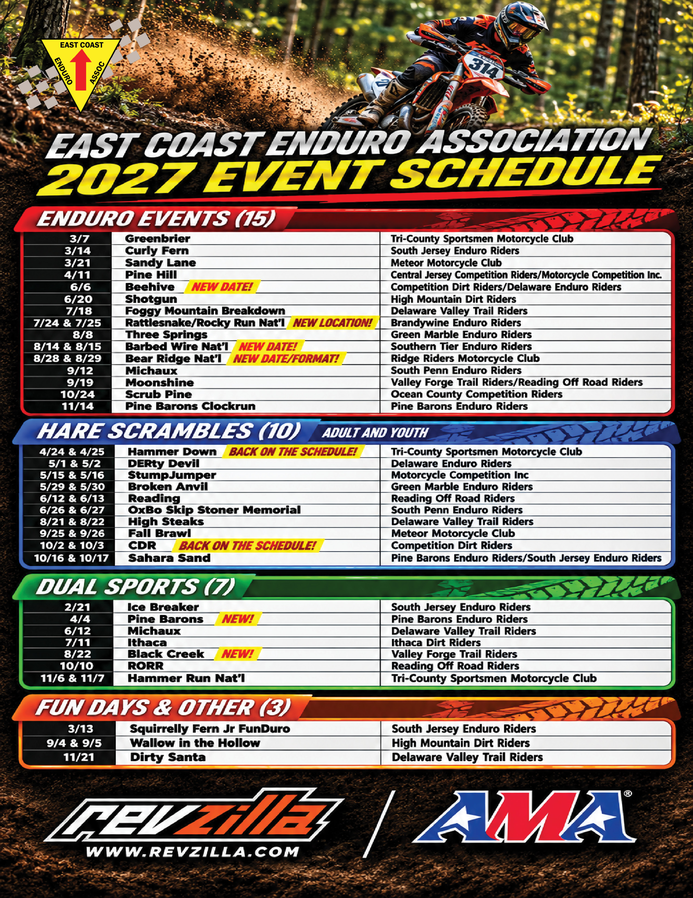

# The ECEA 2027 schedule is here

The official 2027 ECEA event schedule is set: 15 enduros, 10 hare scrambles (adult and youth), 7 dual sports, and 3 fun days. Full details for each event will be posted on the [Events](/events) page as they become available.

